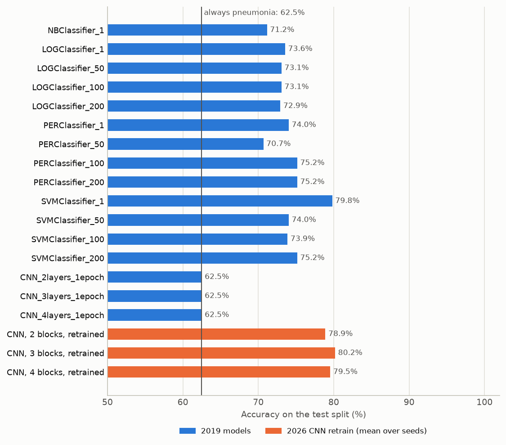

# Project Marrow: pneumonia in chest X-rays

[](https://github.com/michaelperez023/MLFinalProject/actions/workflows/ci.yml)

Classifies chest X-ray images as pneumonia or normal with scikit-learn models (multinomial
Naive Bayes, and linear models trained by stochastic gradient descent) and a small Keras
convolutional network. Team final project for CAP 4612 (machine learning) at Florida
Polytechnic University, fall 2019, by Peter Akioyamen, Michael Perez, Jeffrey Krakowiak and
the GitHub user JD3153.

This repository keeps the team's 2019 code, saved models and results, with small fixes so
that they run today, tests, and a script that re-runs everything on a GPU machine.
It is a course exercise, not a diagnostic tool.

## Team and roles

From the commit history: `git shortlog`, and `git blame` of the 933 lines of Python in the last
2019 commit (38f801a).

| Member | Commits in 2019 | Lines of Python | Work shown in the history |
| --- | ---: | ---: | --- |
| Peter Akioyamen ([peter-ai](https://github.com/peter-ai)) | 37 | 824 (88%) | the preprocessing script; the `ML_DataPipeline` package and its usage notes; the Naive Bayes (with Jeffrey), SVM, logistic regression and perceptron training scripts; the 200-epoch training runs on the university's HPC cluster and their logs; the benchmark script and `Results/Test_Results.xlsx`; the pipeline test script; the first version of the presentation demo; the repository layout |
| Michael Perez ([michaelperez023](https://github.com/michaelperez023)) | 9 | 75 (8%) | created the repository; wrote the Keras CNN script (`CNN_Model/pneumonia_cnn.py`) and uploaded trained CNNs, including `CNN_2layers_1epoch.h5` |
| Jeffrey Krakowiak ([jkrakowiak](https://github.com/jkrakowiak)) | 2 | 11 (1%) | the first Naive Bayes training script (Gaussian, then multinomial Naive Bayes) |
| [JD3153](https://github.com/JD3153) | 1 | 23 (2%) | extended the presentation demo to compare Naive Bayes with the SVM (December 2019) |

Peter's commits include 5 merges and one made on GitHub's website as `peter-ai`. The
3- and 4-block CNNs were added by Peter when he reorganized the repository; the history does
not show who trained them. The 2026 updates are by Michael Perez.

## Data

Daniel Kermany, Kang Zhang and Michael Goldbaum (2018), "Labeled Optical Coherence Tomography
(OCT) and Chest X-Ray Images for Classification", Mendeley Data, V2,
[doi:10.17632/rscbjbr9sj.2](https://doi.org/10.17632/rscbjbr9sj.2), licensed
[CC BY 4.0](https://creativecommons.org/licenses/by/4.0/). The chest X-rays are the archive
`ChestXRay2017.zip` (1,235,512,464 bytes, SHA-256
`13efc055629733dbab07877f8b3c9f81097840dbcdaa326a8542322c2281ce36`). The images and their
labelling are described in Kermany et al., "Identifying Medical Diagnoses and Treatable
Diseases by Image-Based Deep Learning", Cell 172(5):1122-1131.e9 (2018),
[doi:10.1016/j.cell.2018.02.010](https://doi.org/10.1016/j.cell.2018.02.010).

| Split | Normal | Pneumonia | Total |
| --- | ---: | ---: | ---: |
| train | 1,349 | 3,883 | 5,232 |
| test | 234 | 390 | 624 |

The team used this original split: the saved Naive Bayes model counted 3,883 pneumonia and
1,349 normal training images, and the benchmark scored 12 partitions of 52 test images. (The
widely used Kaggle copy of the dataset moves 16 training images into a validation folder.)
The images are not in this repository, but the saved models were trained on them. Labels are
0 for pneumonia and 1 for normal. Pneumonia makes up 62.5% of the test images, so a model
that always answers "pneumonia" scores 62.5%.

## How it works

| Path | What it does |
| --- | --- |
| `Data_Preprocessing/PictureProcessor.py` | converts the JPEGs to grayscale, resizes them to 750x750 with nearest-neighbour sampling, shuffles them and saves `train_images.pickle` and `test_images.pickle`: a count, then `[label, image]` pairs (about 3.3 GB) |
| `HPC/ML_DataPipeline/` | the `DataPipeline` class: training mini-batches (shuffled within each batch) and 12 test partitions, with the features each model expects: raw pixels (0-255) for Naive Bayes, pixels standardized per image for the SGD models, pixels / 255 as 750x750x1 arrays for the CNN |
| `HPC/NBClassifier.py` | multinomial Naive Bayes, one pass over the training images |
| `HPC/SVMClassifier.py`, `LOGClassifier.py`, `PERClassifier.py` | scikit-learn `SGDClassifier` with the hinge (linear SVM), logistic and perceptron losses on all 562,500 pixels, in mini-batches of 24; saved after 1, 50, 100 and 200 epochs |
| `HPC/Training_Logs/` | the cluster's reports on the three 200-epoch jobs: about 20 hours and 33 CPU hours each (account and host names replaced by placeholders) |
| `CNN_Model/pneumonia_cnn.py` | the Keras CNN: 2, 3 or 4 blocks of 3x3 convolution (16, 32, 64, 128 filters) and 2x2 max pooling, global average pooling, a 64-unit dense layer with L2 regularization, batch normalization and a sigmoid output; trained with plain SGD for one epoch. `load_2019_cnn()` reads the saved 2019 models |
| `CNN_Model/retrain_2026.py` | 2026 addition: trains the same architecture with a validation split, class weights, augmentation and Adam (see [How to run](#how-to-run-today)) |
| `ML_Models_Saved/` | the 13 scikit-learn models and 3 CNNs saved in 2019, and `Model_Benchmark.py`, which scores them on the 12 test partitions |
| `Results/Test_Results.xlsx` | the 2019 benchmark: accuracy per partition and the average (AVG) |
| `Results/2026/` | the 2026 re-run: `rerun_2026.json` (scores, settings, timings, library versions) and its figures |
| `Tests_and_Demos/Beta_Presentation_Demo.py` | the presentation demo: one test image and the Naive Bayes and SVM predictions |
| `scripts/` | 2026: the re-run script for a GPU machine and its helpers |
| `tests/` | 2026: tests on small synthetic images |

## Results in 2019

Accuracy on the 624 test images, from the AVG row of
[`Results/Test_Results.xlsx`](Results/Test_Results.xlsx). The 12 partitions hold 52 images
each, so the average over partitions is the accuracy on the whole test split.

| Model | Epochs | Correct | Accuracy |
| --- | ---: | ---: | ---: |
| Always "pneumonia" (no model) | | 390 | 62.50% |
| Multinomial Naive Bayes | 1 | 444 | 71.15% |
| Logistic regression (SGD) | 1 / 50 / 100 / 200 | 459 / 456 / 456 / 455 | 73.56% / 73.08% / 73.08% / 72.92% |
| Perceptron (SGD) | 1 / 50 / 100 / 200 | 462 / 441 / 469 / 469 | 74.04% / 70.67% / 75.16% / 75.16% |
| Linear SVM (SGD) | 1 / 50 / 100 / 200 | 498 / 462 / 461 / 469 | 79.81% / 74.04% / 73.88% / 75.16% |
| CNN, 2 / 3 / 4 blocks | 1 | 390 each | 62.50% each |

- **The CNNs label every image pneumonia.** All three scored exactly 390 of 624, the number
  of pneumonia images, with the same score as each other in every partition. Their output
  stays below 0.5 on every input tried, from a black or white image to noise
  ([`tests/test_saved_models.py`](tests/test_saved_models.py)). They were trained for one
  epoch of plain SGD on data that is 74% pneumonia, without class weights or a validation
  split. `CNN_Model/retrain_2026.py` retrains the same architecture with changes that let it
  learn (see [2026 re-run](#2026-re-run)).
- The best model, the SVM after one epoch, is 17 points above always answering "pneumonia".
  The four epoch counts were compared on the test split, as there was no validation split,
  so the best of them is an optimistic estimate.
- Only accuracy was measured. On this test split, where 62.5% of the images show pneumonia,
  sensitivity and specificity say more; `Model_Benchmark.py` now reports them, and the ROC
  AUC, with `--metrics-json`. The [2026 re-run](#2026-re-run) gives them for every saved model.
- The SGD scripts asked for batches of 96, which `DataPipeline` replaces with its default of
  24 (the warning is in the training logs), so the saved models were trained with 24.

## How to run today

The code needs Python 3.11 or later, except for most of the 2019 scikit-learn models (below).
[uv](https://docs.astral.sh/uv/) installs the locked versions:

```bash
uv sync --extra cnn --extra plots
uv pip install torch          # Keras backend (CPU only: --index-url https://download.pytorch.org/whl/cpu)
uv run pytest                 # tests on synthetic images, no dataset needed
```

`uv sync` makes `ML_DataPipeline` and `pneumonia_cnn` importable from anywhere; there is no
need to copy files into `site-packages` as in 2019. Keras uses PyTorch unless `KERAS_BACKEND`
names another backend. On Intel Macs, where PyTorch stops at 2.2.2, which current Keras
does not support, use TensorFlow instead: `uv pip install tensorflow==2.16.2` and
`export KERAS_BACKEND=tensorflow`.

The dataset is not included: download `ChestXRay2017.zip` from
[Mendeley Data](https://data.mendeley.com/datasets/rscbjbr9sj/2) and unzip it, or let
`uv run python scripts/fetch_dataset.py --downloads downloads --data-dir data` download it,
check its SHA-256 and extract `data/chest_xray`.

### The 2019 models

The scikit-learn models were pickled with scikit-learn 0.21. The Naive Bayes model still loads
with current versions, but the 12 SGD models (logistic regression, perceptron and SVM) refer to
a module that scikit-learn 0.24 removed, so they need 0.23, Python 3.8 and
[`requirements-2019.txt`](requirements-2019.txt). That file also pins Pillow 6, the version
line of 2019: later Pillow releases turn color JPEGs into slightly different gray levels, so
the 2019 features are only rebuilt exactly with it. Its packages have wheels for Linux, Intel
Macs and Windows; NumPy 1.19 has none for Apple Silicon, where an x86_64 build of Python 3.8
(running under Rosetta 2) is needed.

```bash
uv venv --python 3.8 ../marrow-2019
uv pip install --python ../marrow-2019 -r requirements-2019.txt
export PYTHONPATH=HPC:CNN_Model
../marrow-2019/bin/python Data_Preprocessing/PictureProcessor.py --dataset-dir data/chest_xray --out-dir data/pipeline
../marrow-2019/bin/python ML_Models_Saved/Model_Benchmark.py --data-dir data/pipeline \
    --models "*.pickle" --out out/sklearn.xlsx --metrics-json out/sklearn.json
../marrow-2019/bin/python Tests_and_Demos/Beta_Presentation_Demo.py --data-dir data/pipeline
```

Loading a pickle file can run code. The saved models only rebuild NumPy arrays and
scikit-learn objects; [`tests/test_saved_models.py`](tests/test_saved_models.py) checks this
without loading them.

The 2019 CNNs (`.h5`) were saved with Keras 2.3.1, which `keras.models.load_model()` in
Keras 3 cannot read; `load_2019_cnn()` rebuilds the architecture and loads the weights:

```bash
uv run python ML_Models_Saved/Model_Benchmark.py --data-dir data/pipeline --models "*.h5" --out out/cnn.xlsx
```

### Training

```bash
uv run python HPC/NBClassifier.py --data-dir data/pipeline --out-dir out/models
uv run python HPC/SVMClassifier.py --data-dir data/pipeline --out-dir out/models  # also LOG, PER
uv run python CNN_Model/pneumonia_cnn.py --data-dir data/pipeline --out out/cnn.keras  # as in 2019
uv run python CNN_Model/retrain_2026.py --dataset-dir data/chest_xray --cache-dir out/cache --out-dir out/runs
```

`DataPipeline` keeps a dataset in memory once it has read it: about 2.9 GB for the training
images. `retrain_2026.py` is a 2026 addition. It trains the 2019 architecture on 256x256
images resized from the original JPEGs, with a stratified validation split of 10% of the
training images, class weights for the imbalance, small random rotations, shifts, zoom and
contrast changes, and Adam (learning rate 1e-3, halved when the validation loss stalls) for
up to 40 epochs. It keeps the epoch with the best validation ROC AUC, stops after 8 epochs
without a better one, and scores that model once on the test split: accuracy, sensitivity
(pneumonia found), specificity (normal images cleared), precision, ROC AUC and the confusion
matrix, with pneumonia as the positive class.

### Re-running everything on a GPU machine

[`scripts/desktop_rerun.sh`](scripts/desktop_rerun.sh) does all of the above unattended on a
Linux machine with an NVIDIA GPU (8 GB is enough) and conda:

1. creates a Python 3.8 environment from `requirements-2019.txt` and a Python 3.12 one from
   [`scripts/requirements-rerun.txt`](scripts/requirements-rerun.txt) (the versions of
   `uv.lock` and PyTorch 2.14.1, whose CUDA 13 build needs NVIDIA driver 580 or later)
2. downloads the dataset from Mendeley Data and checks its size and SHA-256
3. rebuilds the 2019 pickles with `PictureProcessor.py` in the Python 3.8 environment
4. scores the 13 scikit-learn models (Python 3.8) and the 3 CNNs (Keras 3), and checks the
   AVG row of `Results/Test_Results.xlsx` model by model
5. retrains the CNN with 2, 3 and 4 blocks and seeds 42, 43 and 44
6. writes `results/rerun_2026.json` (scores, timings, library versions, GPU) and figures

```bash
bash scripts/desktop_rerun.sh ~/mlf-check
```

Everything it writes, including the environments and caches (about 15 GB), stays in the
folder given as its argument, which must be new or empty the first time; the repository is
only read. Each step records when it has finished, so the script can be stopped and started
again with the same command; a step is redone when its inputs change, including the
requirements of the environment it runs in. Logs and timings are in `~/mlf-check/logs`. The
comments at the top of the script list its settings.

## 2026 re-run

`scripts/desktop_rerun.sh` ran unattended from start to finish in about two hours, at commit
`ff3ff74`, on a Linux desktop with an NVIDIA GeForce RTX 2070 SUPER (8 GB, driver 580.178.04)
and an AMD Ryzen Threadripper 1920X. The preprocessing and the scikit-learn models ran in the
Python 3.8 environment (Python 3.8.20, scikit-learn 0.23.2, NumPy 1.19.5, SciPy 1.5.4, Pillow
6.2.1, pandas 1.1.5), the CNNs in the Python 3.12 one (Python 3.12.16, Keras 3.15.1 on PyTorch
2.14.1 with CUDA 13.0 and cuDNN 9.24, NumPy 2.5.5, scikit-learn 1.9.1, Pillow 13.0.0). The
downloaded archive had the size, SHA-256 and image counts given under [Data](#data). The
scores, settings, timings and versions are in
[`Results/2026/rerun_2026.json`](Results/2026/rerun_2026.json).

### The 2019 models, scored again

All 16 saved models gave exactly the accuracy in the AVG row of `Results/Test_Results.xlsx`:
model by model, the same number of correct answers out of the 624 test images as in 2019 (the
AVG values differ by at most 2.2e-16, floating-point rounding). So the dataset as downloaded
in 2026, the features rebuilt by `PictureProcessor.py` with Pillow 6, and the models as loaded
now (the pickles with scikit-learn 0.23.2, the CNNs with `load_2019_cnn()` under Keras 3) give
the team's 2019 results, and the scores that were not measured in 2019 can be added for the
same models:

| Model | Epochs | Sensitivity | Specificity | ROC AUC |
| --- | ---: | ---: | ---: | ---: |
| Multinomial Naive Bayes | 1 | 71.3% | 70.9% | 0.804 |
| Logistic regression (SGD) | 1 / 50 / 100 / 200 | 97.2% / 98.7% / 98.7% / 98.7% | 34.2% / 30.3% / 30.3% / 29.9% | 0.870 / 0.881 / 0.881 / 0.881 |
| Perceptron (SGD) | 1 / 50 / 100 / 200 | 97.4% / 99.5% / 98.2% / 98.2% | 35.0% / 22.6% / 36.8% / 36.8% | 0.854 / 0.887 / 0.898 / 0.898 |
| Linear SVM (SGD) | 1 / 50 / 100 / 200 | 94.4% / 98.2% / 98.2% / 97.7% | 55.6% / 33.8% / 33.3% / 37.6% | 0.897 / 0.880 / 0.880 / 0.891 |
| CNN, 2 / 3 / 4 blocks | 1 | 100% each | 0% each | 0.673 / 0.751 / 0.744 |

The three CNNs label every test image pneumonia: sensitivity 100% and specificity 0%, 390 of
624 correct, as many as always answering "pneumonia". None of their outputs is above 0.5,
although they rank the images better than chance (ROC AUC 0.673 to 0.751). The SGD models
lean towards pneumonia too: they find 94.4% to 99.5% of the pneumonia images but clear only
22.6% to 55.6% of the normal ones. Naive Bayes is the most balanced (71.3% and 70.9%).

### The CNN retrained

`retrain_2026.py` trained each depth with seeds 42, 43 and 44 as described under
[Training](#training), on 4,709 training and 523 validation images in batches of 32. Scores on
the 624 test images at the 0.5 threshold, as the mean over the three seeds with the lowest and
highest in brackets (precision is the share of the images labelled pneumonia that show it):

| Retrained CNN | 2 blocks | 3 blocks | 4 blocks |
| --- | ---: | ---: | ---: |
| Parameters | 7,233 | 27,777 | 105,729 |
| Accuracy | 78.9% (77.1-81.4) | 80.2% (77.6-85.1) | 79.5% (75.2-82.9) |
| Sensitivity | 89.8% (87.2-94.1) | 96.7% (94.4-97.9) | 97.4% (94.9-99.2) |
| Specificity | 60.7% (48.7-70.1) | 52.7% (43.6-69.7) | 49.9% (35.0-57.7) |
| Precision | 79.4% (75.4-83.1) | 77.6% (74.3-83.8) | 76.6% (71.8-79.4) |
| ROC AUC | 0.878 (0.867-0.887) | 0.914 (0.903-0.924) | 0.920 (0.902-0.933) |
| Best epoch, seeds 42 / 43 / 44 | 27 of 35 / 27 of 35 / 19 of 27 | 37 of 40 / 28 of 36 / 33 of 40 | 35 of 40 / 23 of 31 / 39 of 40 |
| Training time (minutes), seeds 42 / 43 / 44 | 11.1 / 11.2 / 8.6 | 13.5 / 12.1 / 13.3 | 13.7 / 10.6 / 13.7 |

The nine runs took 1 hour 48 minutes, and none allocated more than 0.78 GiB of GPU memory.



The figures are in [`Results/2026/figures`](Results/2026/figures):
[`test_accuracy.png`](Results/2026/figures/test_accuracy.png) (above),
[`roc_2026.png`](Results/2026/figures/roc_2026.png) (test ROC curves of the nine runs),
[`confusion_2026.png`](Results/2026/figures/confusion_2026.png) (test confusion matrices of the
seed-42 runs) and [`training_2026.png`](Results/2026/figures/training_2026.png) (validation
ROC AUC and loss by epoch; the loss jumps between epochs in every run).

- **The retrained CNNs learn.** Their test ROC AUC is 0.867 to 0.933, against 0.673 to 0.751
  for the 2019 CNNs, and unlike those they do label normal images normal. Every 3- and 4-block
  run (0.902 to 0.933) ranks the test images better than any 2019 model, whose best is 0.898
  (the perceptron after 100 or 200 epochs); the 2-block runs (0.867 to 0.887) do not.
- They still call many normal images pneumonia. At the 0.5 threshold they find 87.2% to 99.2%
  of the pneumonia images but clear only 35.0% to 70.1% of the normal ones, the same pattern as
  the 2019 SGD models. In every run most errors are normal images labelled pneumonia: 960 of
  the 1,149 errors of the nine runs.
- The test split is harder for them than the validation images, which come from the training
  split: there the same models score 88.0% to 96.9% accuracy, clear 85.2% to 98.5% of the
  normal images and reach ROC AUC 0.955 to 0.996, and every run does worse on the test split
  in all three. The validation scores, which chose each run's epoch, overstate how the models
  do on the test images.
- On accuracy they are about level with the best 2019 model: 78.9%, 80.2% and 79.5% on average
  for 2, 3 and 4 blocks, against 79.8% for the SVM after one epoch, which was chosen on the
  test split itself. Four of the nine runs score higher (up to 85.1%), five lower (down to
  75.2%).
- Between the three seeds of one depth, specificity varies by 21 to 26 points and accuracy by
  4 to 8, more than the means of the depths differ. Depth stands out only in sensitivity and
  ROC AUC, where every 3- and 4-block run is above every 2-block run; three seeds do not
  separate 3 from 4 blocks.

## Credits

- The team, as listed above.
- The dataset: Daniel Kermany, Kang Zhang and Michael Goldbaum, Mendeley Data,
  [CC BY 4.0](https://creativecommons.org/licenses/by/4.0/); Kermany et al., Cell (2018).
- The CNN script started from a public Keras tutorial on CelebA gender classification, which
  its architecture and comments follow. An earlier draft, deleted in 2019, followed the
  "VGG-like convnet" example in the Keras documentation.
- Built with [scikit-learn](https://scikit-learn.org), [Keras](https://keras.io),
  [NumPy](https://numpy.org), [Pillow](https://python-pillow.org) and
  [pandas](https://pandas.pydata.org).

There is no license file; the code was written by the four team members listed above.
